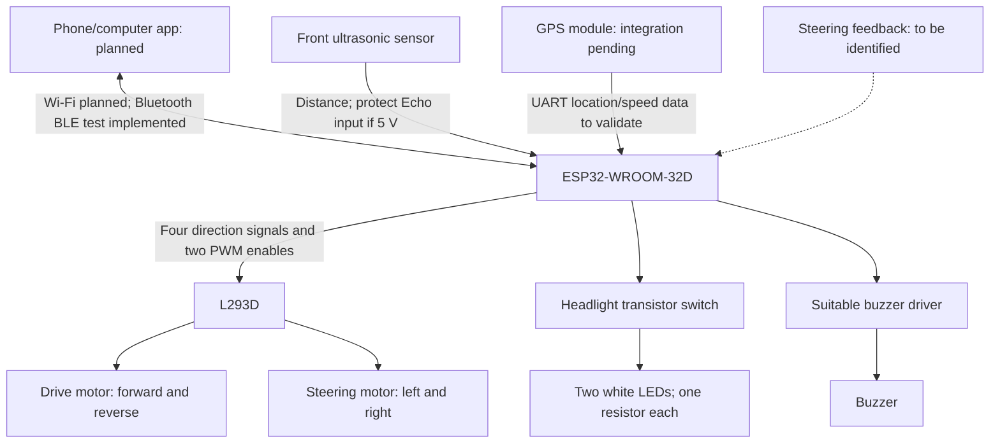
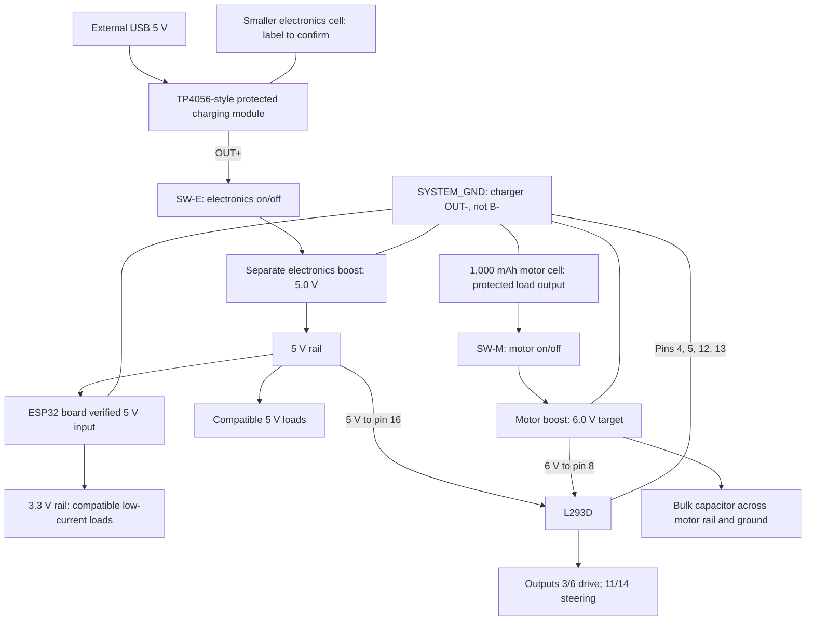
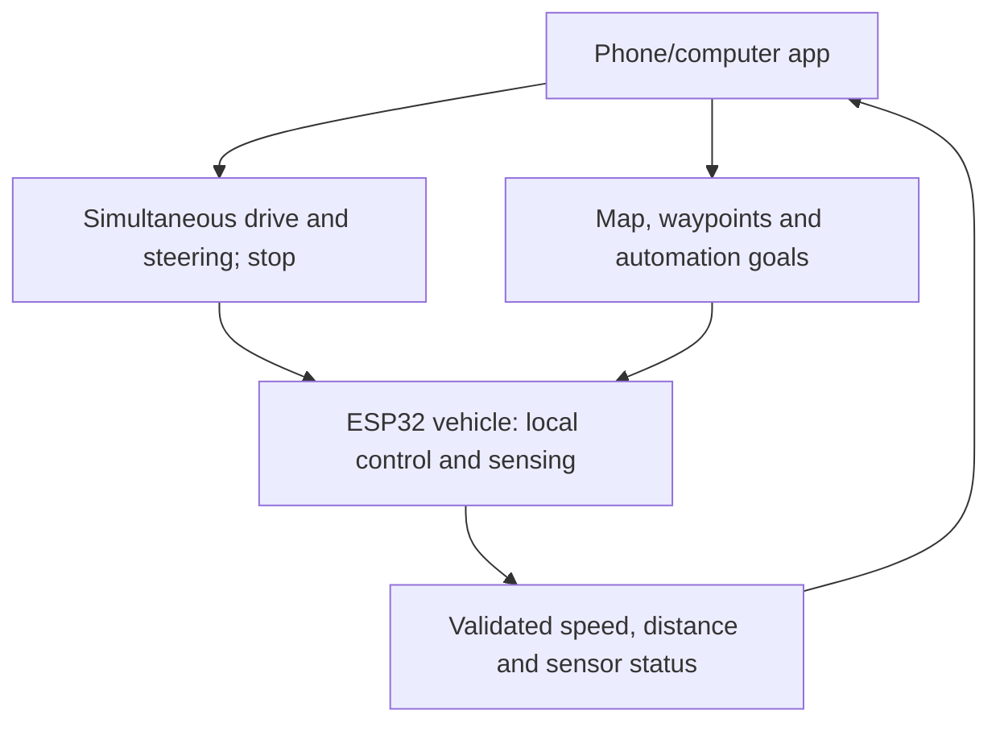

# V2 block diagrams

Current planning revision: October 19, 2026. One ESP32-WROOM-32D vehicle connects directly to a phone/computer app over Wi-Fi or Bluetooth. These are architecture diagrams, not a pin-level wiring schematic.

## Signals and control

The app roadmap covers simultaneous control, navigation/maps, sensing, automation, waypoints, distance traveled, speed and diagnostics. See [app plan](../documentation/ui/APP_PLAN.md) and [wireless plan](../documentation/network/WIRELESS_LINK.md). USB Serial remains a bench interface. GPS, accessory sensing and automation below are planned, not integrated telemetry.

Feedback is conditional. A two-wire steering motor does not report steering angle. Inspect centering springs, end stops, and any position sensor before choosing a control strategy.

## Power

Latest source selection: 1,000 mAh motor cell and smaller electronics cell. Diagram shows intended load topology, not a completed battery/charger wiring schematic. See [battery decision](../documentation/power/BATTERY_REALLOCATION.md). Bench driving/steering success does not validate portable conversion or charging.

Detailed terminal assignments: [power pinout plan](../documentation/pin-configuration/POWER_PINOUT.md).

Ground lines indicate shared load returns: protected motor-cell load negative, both converter returns, ESP32 GND, L293D ground pins, and accessory grounds join SYSTEM_GND. Motor return wiring goes directly to the motor branch protected load return rather than through the ESP32 board. Raw rechargeable-cell B- stays only on the battery side of the protection circuit.

Two boost stages are selected; physical identities and complete battery-powered integration remain unverified. A buck-only converter cannot supply either voltage increase. Positive rails remain separate. GPS rail and exact ESP32 development-board input must be confirmed.

Both on/off switches are OFF for storage/load shutdown and charging. The charger stays connected to the cell. No charge-and-run load-sharing circuit is included. The earlier ordinary three-cell pack is superseded by a selected 1,000 mAh motor cell. A separate suitable charging/protection arrangement for that motor cell is not yet specified; do not join cells on one charger.

The motor-only test GPIOs and commands are recorded in the [BLE testing guide](../firmware/testing/README.md); sensor/accessory signal wiring remains pending. This power architecture is a draft, pending actual module, current, charge-rate, and mixed-power-state checks.

## How to read this plan

The switches perform an SPST on/off function. The user reported a three-terminal switch, likely SPDT: verify its common and one connected outer terminal, leaving the other outer terminal unused. This is the same two-branch architecture.

This diagram shows intended final wiring. USB-fed ESP32 5 V and fixed HIGH driver-input jumpers were temporary bench-test arrangements. They are not an extra power route in the final plan. Remove fixed 5 V control jumpers before GPIO wiring; the final L293D logic supply stays at pin 16.

The motor ran with its supply switch off during the reported bench test. That is an unresolved observation, not intended behavior depicted by this diagram. See [test log](../documentation/testing/TEST_LOG.md) and [limitations](../limitations/LIMITATIONS.md). GPIO test code now exists, but power isolation and startup/disconnect/stop performance are not electrically validated.

Latest capacitor observation: the user reports1,000 uF/50 V and pre-existing motor ceramics; audible noise persisted. Earlier supply planning named 100 uF. The diagram shows recommended bulk-filter placement, not proof of the actual installation. See [noise/load investigation](../documentation/testing/MOTOR_NOISE_AND_LOAD.md). The latest battery allocation supersedes the earlier three-cell source; protection/charging details are pending.

## Planned app functions and feedback

This describes intended data flow. Current logs are commanded GPIO/PWM states; speed, distance, GPS/map and sensor readings must not be displayed as measured until implemented and validated. Local stop/obstacle behavior remains necessary when the app disconnects.
