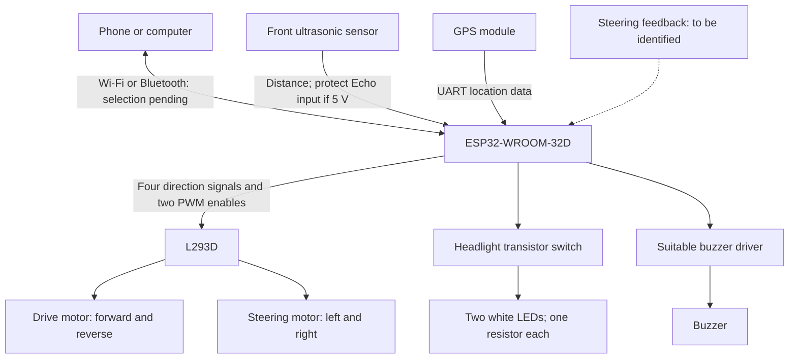
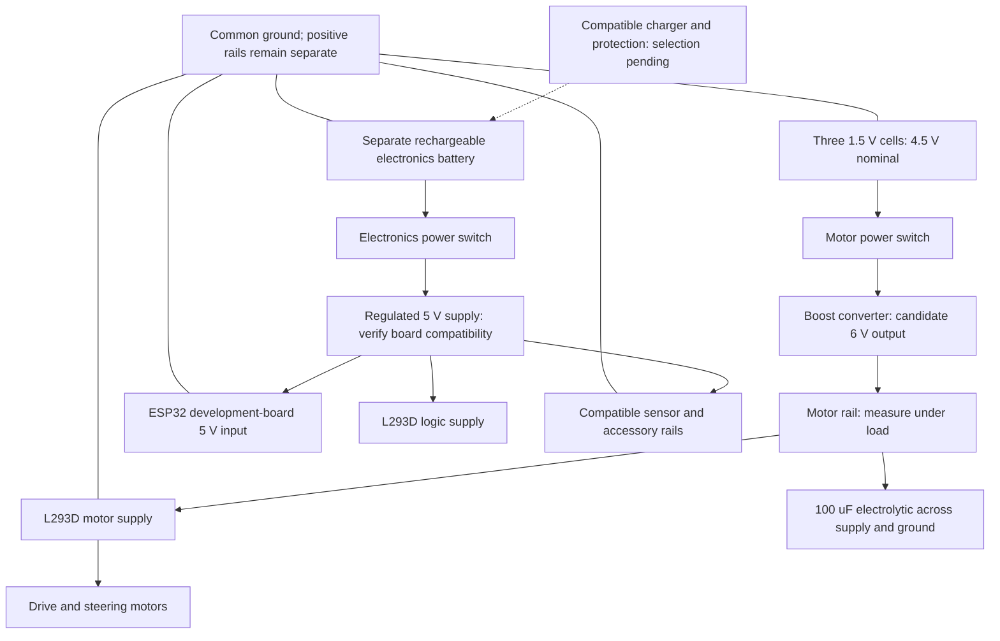

# V2 block diagrams

Current planning revision: October 16, 2026. These are architecture diagrams, not a pin-level wiring schematic.

## Signals and control

Feedback is conditional. A two-wire steering motor does not report steering angle. Inspect centering springs, end stops, and any position sensor before choosing a control strategy.

## Power

The candidate boost path replaces the unresolved direct 4.5 V motor path; it is not yet a validated supply. GPS and other module rails must match their exact breakout requirements. The ESP32 module itself uses 3.3 V; the 5 V input shown is for a suitable development board regulator.

The charger is a future design item. A boost or buck converter is not a battery charger. Do not charge ordinary non-rechargeable cells. Charger load sharing and operation while charging remain unresolved.
