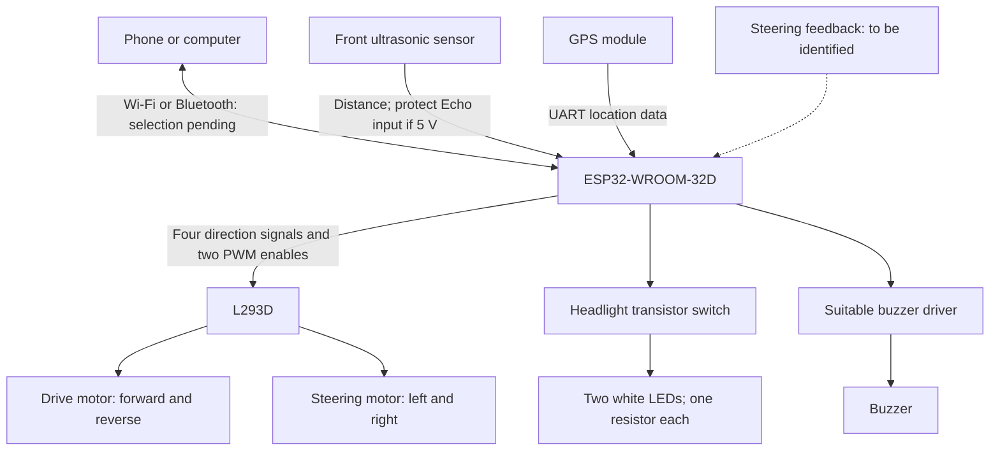
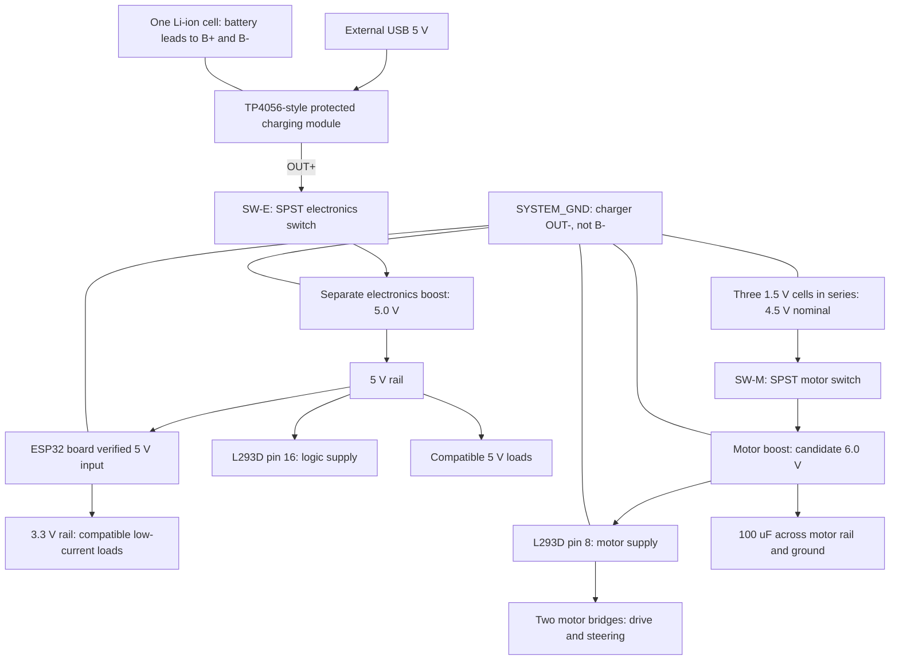

# V2 block diagrams

Current planning revision: October 16, 2026. These are architecture diagrams, not a pin-level wiring schematic.

## Signals and control

Feedback is conditional. A two-wire steering motor does not report steering angle. Inspect centering springs, end stops, and any position sensor before choosing a control strategy.

## Power

Detailed terminal assignments: [power pinout plan](../documentation/pin-configuration/POWER_PINOUT.md).

Ground lines indicate shared load returns: AA negative, both converter returns, ESP32 GND, L293D ground pins, and accessory grounds join SYSTEM_GND. Motor return wiring goes directly to the motor battery negative rather than through the ESP32 board. Raw rechargeable-cell B- stays only on the battery side of the protection circuit.

Two boost stages are required; only one module has been shown. A buck-only converter cannot supply either voltage increase. Positive rails remain separate. GPS rail and exact ESP32 development-board input must be confirmed.

Both SPST switches are OFF for storage/load shutdown and charging. The charger stays connected to the cell. No charge-and-run load-sharing circuit is included. The ordinary three-cell motor pack is not connected to the charger.

GPIOs and analog/digital signal wiring will be assigned separately. This power architecture is a draft, pending actual module, current, charge-rate, and mixed-power-state checks.
